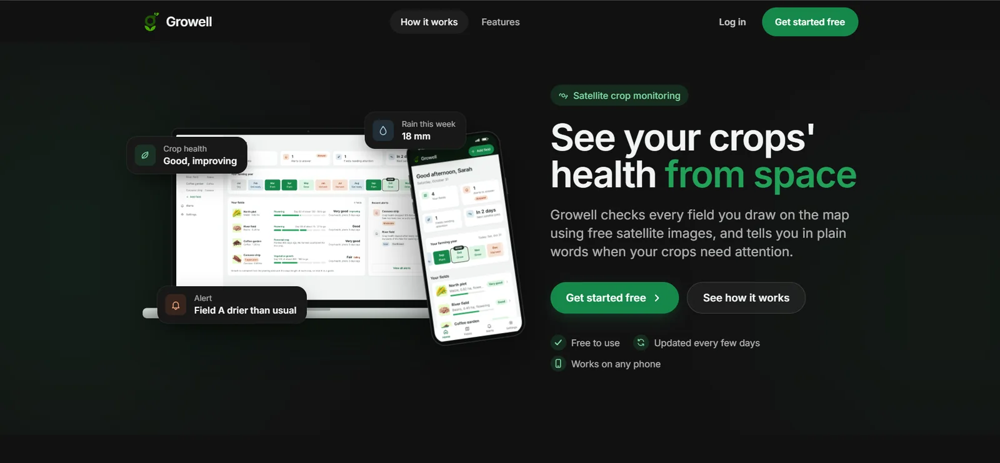
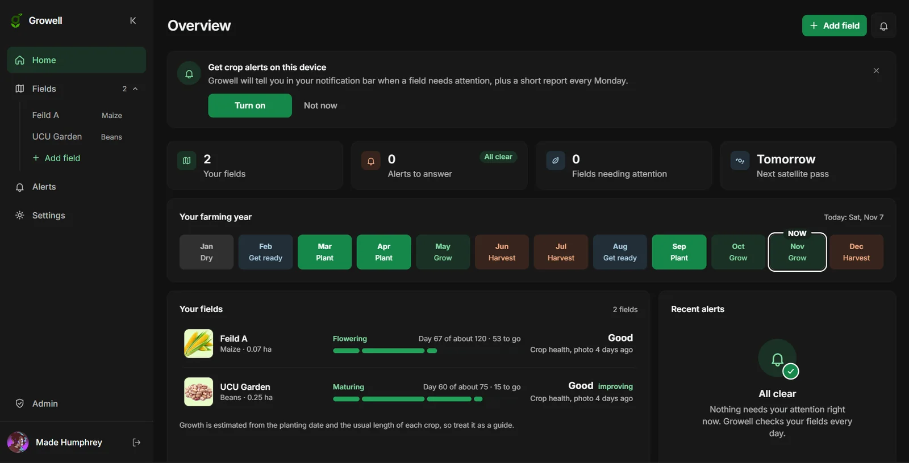
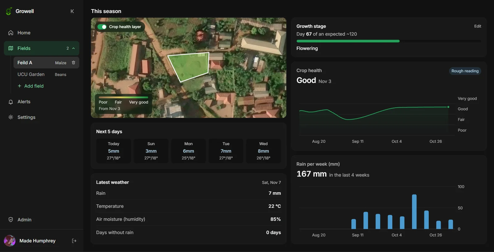
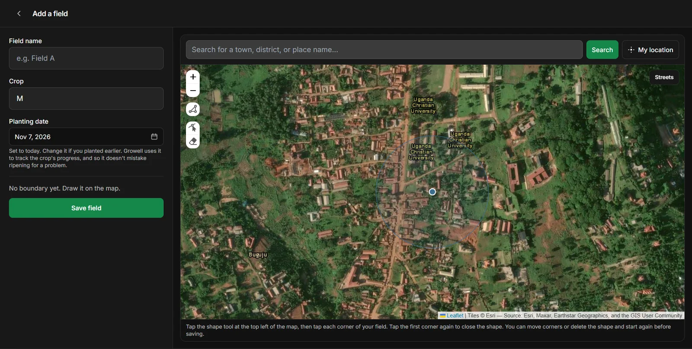
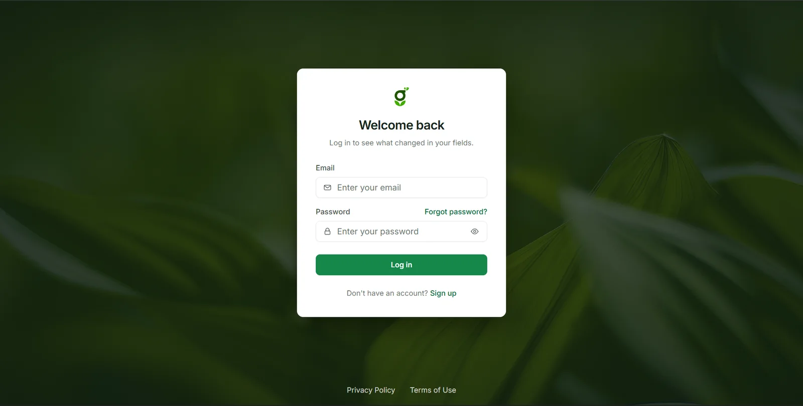
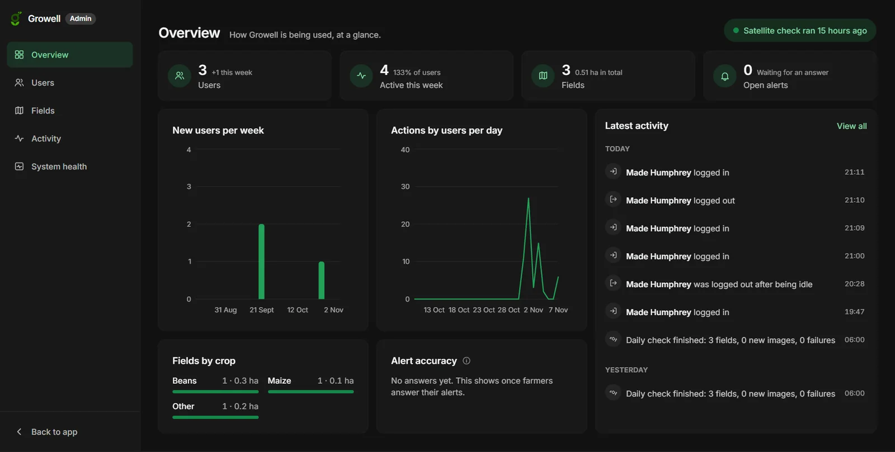
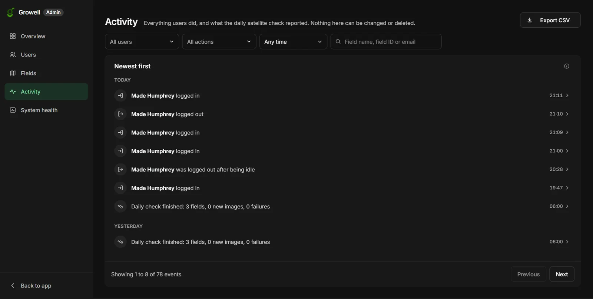

<div align="center">


# Growell

**Crop health monitoring from space, with automatic alerts for farmers.**

Growell uses free Sentinel-2 satellite imagery to track the health of each field a farmer draws on a map. It checks every field daily, compares new readings with the field's own recent history, and sends a plain-language alert with a likely cause and a suggested action when crop health drops.


**[Open the live app](https://growell-ug.vercel.app)**



</div>

---

## About

Growell is the final-year project **"A Web-Based System Using Satellite Imagery for Automated Crop Health Monitoring and Anomaly Detection"** by Made Humphrey at Uganda Christian University.

Many smallholder farmers only notice crop stress once it is visible on the ground, when it is often too late to act cheaply. Satellites see stress earlier, through changes in how plants reflect light. Growell turns that satellite data into something a farmer can read at a glance: a health word (Poor, Fair, Good, Very good), a colour map of the field, and an alert when something changes.

## Screenshots

<table>
  <tr>
    <td width="50%"><br /><b>Home.</b> Every field's growth stage and crop health, the farming year, and alerts.</td>
    <td width="50%"><br /><b>Field.</b> Crop health on the satellite map, the health and rain charts, weather and the 5-day forecast, all on one screen.</td>
  </tr>
  <tr>
    <td width="50%"><br /><b>Add a field.</b> Draw the boundary on the satellite map, choose the crop and the planting date.</td>
    <td width="50%"><br /><b>Log in.</b> Email login with confirmation, password reset, Privacy Policy and Terms.</td>
  </tr>
  <tr>
    <td width="50%"><br /><b>Admin overview.</b> Users, fields, activity charts, alert accuracy and the daily check's status.</td>
    <td width="50%"><br /><b>Admin activity.</b> A tamper-proof audit trail of what every user did, with filters and CSV export.</td>
  </tr>
</table>

## Features

**Fields**
- Draw a field's boundary on a satellite map and save it with its crop and planting date (today by default)
- Crop search covering 73 crops grown in Uganda, including local names (type "kasooli" to find maize), each with its typical time to harvest
- Area in hectares is worked out automatically from the drawn shape
- 90 days of satellite and weather history load as soon as a field is saved, so charts are never empty

**Crop health**
- NDVI (Normalised Difference Vegetation Index) from Sentinel-2, clipped to the field boundary, with clouds and shadows masked out
- Crop health map: the latest clear image shown as a colour layer over the field on a sharp satellite photo
- Crop health chart over time with Poor, Fair, Good and Very good bands
- Weekly rainfall chart, latest weather, and a 5-day forecast
- Growth stage tracking from the planting date and the crop's time to harvest, including perennial crops such as coffee and matooke

**Alerts**
- A daily server job checks every field, whether or not anyone logs in
- An alert is raised when crop health falls more than 15% below the field's recent average
- Each alert names a likely cause (dry spell, too much rain, or possible pests or disease) and a suggested action
- In-app notification bell, live pop-up alerts, and an Alerts page where farmers confirm whether an alert was accurate
- Each field is also checked for new images once per login, with automatic retries
- Notifications in the phone's or computer's notification bar for new alerts, plus a weekly field report every Monday (Web Push, no app store needed)

**Accounts and app**
- Email sign-up and login with email confirmation and password reset
- Profile photo, account deactivation, and automatic sign-out after 20 minutes of inactivity
- Light and dark mode, a layout that works on phones, tablets and computers, and support for keyboard and screen readers
- Data is cached in the browser, so the last loaded view still shows when the connection drops

**Admin**
- Overview of users, fields, activity, alert accuracy and the daily check's health
- Users and fields (as a table or a map), each with its own detail page
- An audit trail of every account, login, field and alert event that nobody can edit or delete
- Read-only: admin rights are checked by the database on every request

**Privacy**
- Privacy Policy and Terms of Use written for Uganda's Data Protection and Privacy Act, 2019, with consent recorded at sign-up
- Farmers can download all their data, and delete their account and data themselves at any time

## How it works

```
 Sentinel-2 imagery  ─┐
 (Copernicus)         ├─►  Edge Functions  ─►  Postgres  ─►  React app
 Open-Meteo weather  ─┘    (Supabase)         (Supabase)      (browser)
```

The daily pipeline (`supabase/functions/daily-pipeline`) runs six steps for every field:

1. **Data ingestion.** Fetch the newest Sentinel-2 pass and recent weather for the field.
2. **Pre-processing.** Mask clouds and shadows using the scene classification layer, and skip images that are more than 40% cloud.
3. **Anomaly detection.** Compare the new NDVI reading with the average of the field's last 30 readings. A drop of more than 15% is an anomaly.
4. **Cause inference.** Use recent rainfall to suggest a likely cause: under 3 mm points to a dry spell, over 12 mm to waterlogging, anything in between to possible pests or disease.
5. **Recommendation.** Pick a practical next step for that cause.
6. **Alert generation.** Save the alert, which reaches the farmer's browser in real time and their notification bar.

Two more functions support the app:
- **`backfill-field`** loads 90 days of history for a new field, and is also used for the once-per-login check. It never creates alerts for past dates.
- **`field-frame`** builds the cloud-free crop health picture of a field for its latest image, and caches it in storage.
- **`notify`** sends the weekly field report, and test notifications from Settings.
- **`delete-account`** deletes a farmer's account and all their data when they ask.

## Tech stack

| Layer | Tools |
|---|---|
| Frontend | React 18, TypeScript, Vite, Tailwind CSS, React Router |
| Data and caching | TanStack Query with a browser-stored cache |
| Maps | Leaflet, React Leaflet, Leaflet-Geoman (boundary drawing), Turf.js (area) |
| Charts | Recharts |
| Backend | Supabase: Postgres with row level security, Auth, Storage, Realtime, Edge Functions (Deno) |
| Satellite data | Copernicus Data Space Ecosystem, Sentinel Hub Statistical and Process APIs |
| Weather | Open-Meteo (free, no key needed) |
| Basemap and search | Esri World Imagery tiles, OpenStreetMap Nominatim |
| Hosting | Vercel |

## Project structure

```
growell/
├── public/                  Logo, images and crop photos
├── src/
│   ├── pages/               Landing, Login, Signup, Home, FieldDetail, AddField, AlertsPage, Account
│   ├── components/          Layout, sidebar, charts, crop health map, alerts, dialogs, form controls
│   ├── hooks/               Data loading, live alerts, theme, idle sign-out, online status
│   └── lib/                 Supabase client, API calls, NDVI colours, crop stages, helpers
├── supabase/
│   ├── schema.sql           Tables, row level security and functions
│   ├── patch_001 … 013.sql  Database updates, run in order after schema.sql
│   ├── seed.sql             Optional demo data
│   ├── email-templates/     Sign-up and password reset emails
│   ├── SENTINEL_SETUP.md    How to get the satellite data keys
│   └── functions/           daily-pipeline, backfill-field, field-frame, and shared code
└── vercel.json              Hosting settings
```

## Getting started

### What you need

- Node.js 18 or newer
- A free [Supabase](https://supabase.com) project
- A free [Copernicus Data Space Ecosystem](https://dataspace.copernicus.eu) account for satellite data (see `supabase/SENTINEL_SETUP.md`)

### 1. Set up the database

In the Supabase SQL Editor, run these files in this order:

1. `supabase/schema.sql`
2. `supabase/patch_001_anomaly_update_policy.sql` through `supabase/patch_013_admin_active_users_fix.sql`, one at a time, in number order

To make an account admin (it then sees the admin section at `/admin`), run:

```sql
insert into public.admins (user_id) select id from auth.users where email = 'YOUR_EMAIL' on conflict do nothing;
```

### 2. Add the satellite keys

In Supabase, go to **Edge Functions**, then **Secrets**, and add:

| Name | Where to get it |
|---|---|
| `SENTINELHUB_CLIENT_ID` | Copernicus dashboard, OAuth clients |
| `SENTINELHUB_CLIENT_SECRET` | Copernicus dashboard, OAuth clients |
| `PIPELINE_KEY` | A long random key you make (see step 3). Only the daily schedule knows it, so nobody else can start the daily check. |

`SUPABASE_URL`, `SUPABASE_ANON_KEY` and `SUPABASE_SERVICE_ROLE_KEY` are provided to Edge Functions by Supabase automatically.

### 3. Deploy the Edge Functions

From the `growell` folder:

```bash
npx supabase login
npx supabase functions deploy daily-pipeline --no-verify-jwt --project-ref YOUR_PROJECT_REF
npx supabase functions deploy backfill-field --no-verify-jwt --project-ref YOUR_PROJECT_REF
npx supabase functions deploy field-frame --no-verify-jwt --project-ref YOUR_PROJECT_REF
npx supabase functions deploy delete-account --no-verify-jwt --project-ref YOUR_PROJECT_REF
npx supabase functions deploy notify --no-verify-jwt --project-ref YOUR_PROJECT_REF
```

### Notifications (alerts and the weekly report)

Growell sends alerts and a Monday field report to the phone's or computer's notification bar (Web Push, no app store needed).

1. Make a key pair: `npx web-push generate-vapid-keys`
2. Give it to the functions:
   `npx supabase secrets set VAPID_PUBLIC_KEY=... VAPID_PRIVATE_KEY=... VAPID_SUBJECT=mailto:you@example.com --project-ref YOUR_PROJECT_REF`
3. Redeploy `daily-pipeline` and deploy `notify`.
4. Schedule the weekly report with the SQL at the bottom of `supabase/patch_012_notifications_crops_signup.sql`.

Farmers turn notifications on in Settings, Notifications. On iPhone and iPad it works once Growell is added to the Home Screen (iOS 16.4 or newer).

For the "account deleted" confirmation email, add two secrets: `GMAIL_USER` (the Gmail address that sends it) and `GMAIL_APP_PASSWORD` (a Google app password for it, made under Google Account, Security, 2-Step Verification, App passwords). Without them, accounts are still deleted and the confirmation shows on screen.

Then protect and schedule the daily check:

1. Make a key: `node -e "console.log(require('crypto').randomBytes(32).toString('hex'))"`
2. Give it to the function: `npx supabase secrets set PIPELINE_KEY=THE_KEY --project-ref YOUR_PROJECT_REF`
3. In **Database**, then **Extensions**, turn on `pg_cron` and `pg_net`.
4. Follow section 4 at the bottom of `supabase/patch_011_legal_security_accuracy.sql`: it stores the key in the encrypted Vault and schedules the check every day at 03:00 UTC (06:00 in Uganda).

`daily-pipeline` refuses any call without the key. `backfill-field` and `field-frame` only work for the signed-in owner of the field.

### 4. Run the app locally

```bash
cp .env.example .env
npm install
npm run dev
```

Fill in `.env` with your Supabase details from **Project Settings**, then **API**:

```
VITE_SUPABASE_URL=https://YOUR_PROJECT_REF.supabase.co
VITE_SUPABASE_ANON_KEY=your-anon-public-key
```

Open http://localhost:5173, create an account, and add your first field.

## Deployment

The app is a static Vite build hosted on Vercel, which rebuilds the site on every push to `main`.

1. Import the repository in Vercel. Build settings come from `vercel.json`.
2. Add `VITE_SUPABASE_URL` and `VITE_SUPABASE_ANON_KEY` as environment variables.
3. In Supabase, under **Authentication**, then **URL Configuration**, set the Site URL to the live address and add `https://YOUR-SITE.vercel.app/**` to the Redirect URLs, so confirmation and password reset emails link to the live site.

On Vercel, link previews (the `og:image` tag) automatically use the live address. To use a custom domain instead, add `VITE_SITE_URL=https://your-domain` as an environment variable.

The anon key is meant to be public. Row level security makes sure each farmer can only read and change their own data. The service role key is only used inside Edge Functions and must never be added to the website or to the repository.

## Privacy and legal

Growell follows Uganda's Data Protection and Privacy Act, 2019 (Cap. 97):

- A Privacy Policy (`/privacy`) and Terms of Use (`/terms`), in plain English, linked from the landing page, login and sign-up.
- Consent at sign-up, recorded with the policy version and time. Existing accounts are asked once. Changing `TERMS_VERSION` in `src/lib/legal.ts` asks everyone again.
- Farmers can download all their data from Settings, and delete their account there. Deletion is immediate, removes stored files too, and emails a confirmation (`delete-account` function).
- When an account is deleted, its name, email and typed answers are removed from the activity history.

Before a real public launch, check whether Growell must register with the Personal Data Protection Office (pdpo.go.ug), and have the policy reviewed.

## Limitations

- **Image resolution.** Sentinel-2 pixels are 10 m by 10 m. Fields under 0.5 hectares cover only a few pixels, so their readings are marked as rough and nearby land can affect them.
- **Clouds.** Images that are mostly cloud are skipped, so in the rainy season there can be gaps of a week or more between readings.
- **Cause inference is rule-based.** Likely causes come from rainfall alone. They are a starting point for the farmer to check in the field, not a diagnosis.
- **Satellite revisit.** Sentinel-2 passes over a location every 2 to 5 days, so Growell cannot be more current than the latest pass.

## Data sources and credits

- Satellite imagery: contains modified Copernicus Sentinel data, processed through the Copernicus Data Space Ecosystem
- Weather: [Open-Meteo](https://open-meteo.com)
- Basemap: Esri World Imagery
- Place search: [OpenStreetMap](https://www.openstreetmap.org/copyright) Nominatim

## Author

**Made Humphrey**<br />
Uganda Christian University

Final-year project, 2026.<br />
© 2026 Made Humphrey. All rights reserved.
